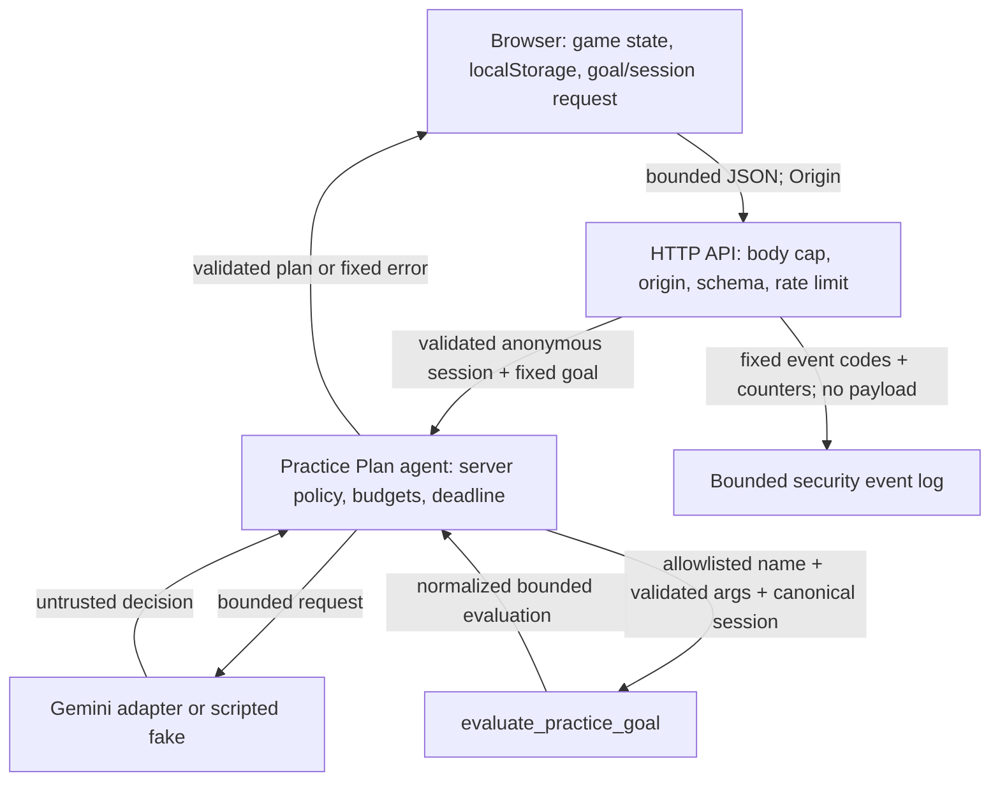

# W08 Evidence: Secure the Arcade

Status: implementation, regression evidence, team contributions and human
sign-off recorded on 2026-10-25.

## 1. Checkpoint

- W08 implementation parent checkpoint: `7bb1b8b` (W05 state immediately
  before the W08 implementation commit `7e6b3dd`); baseline fixtures were
  replayed against an isolated `git archive` of this commit with a scripted
  fake provider on 2026-10-25.
- Original pre-W08 team report: [`specs/specweek05/EVIDENCE_W05.md`](../specweek05/EVIDENCE_W05.md).
  Week 5 was completed before this W08 assignment and its report records the
  team's original W05 implementation, tests and live smoke. The archived-source
  replay described here is a separate retrospective comparison for W08's three
  before/after scenarios; it supplements the original W05 report.
- Final reproducibility checkpoint: `main@2262f9920fe1a32a96da29d911c78e6484589e36`
  (`origin/main` points to the same commit). The tracked working tree was clean
  at that final commit; the current checkout additionally contains an
  untracked `scripts/` directory that is outside the committed checkpoint.
- Game/W05 scope: RetroSnake W05 Practice Plan agent and browser game.
- Review and final verification date: 2026-10-25, Europe/Belgrade. The team
  confirms that both Jovana Grujić and Jelena Kantarević locally ran the final
  validation commands and test suites recorded below.

## 2. Baseline commands and results

| Command | Result | Notes |
|---|---|---|
| `npm run typecheck` | Passed | Exact lockfile installation; `tsc --noEmit` |
| `env W08_TEST_SYNTHETIC_SECRET=w08-synthetic-secret-7d2c npm test` | Passed | 5 files, 175 tests; no live provider |
| `npm run build` | Passed | Vite 8.3.3; `dist/assets/index-B3a39rUY.js`, 19.14 kB |
| `npm run test:e2e` | Passed | Playwright Chromium, 15/15 tests; production preview and browser checks |
| `npm audit --audit-level=moderate` | Passed | `found 0 vulnerabilities` |
| `npm audit --omit=dev --audit-level=moderate` | Passed | `found 0 vulnerabilities` |
| `npm ci` | Passed | Installed lockfile versions; audited 87 packages, 0 vulnerabilities |
| `npm ls --depth=0` | Passed | Vite 8.3.3, Vitest 5.0.3, Zod 4.6.6; all top-level dependencies valid |
| `npm.cmd audit --audit-level=moderate` (before) | 5 vulnerabilities | Human baseline: 2 moderate and 3 high, including zod/vite/source-map-js/vitest findings |
| `npm.cmd audit --omit=dev --audit-level=moderate` (before) | 1 high vulnerability | Human baseline: runtime `zod` finding |
| `npm.cmd audit --audit-level=moderate` (after) | Passed | `found 0 vulnerabilities` |
| `npm.cmd audit --omit=dev --audit-level=moderate` (after) | Passed | `found 0 vulnerabilities` |

Both team members confirm they locally ran the final typecheck, unit/integration
tests, production build, Playwright browser suite, and both dependency audit
commands listed above. The final results were: typecheck passed, 175/175 tests
passed, build passed, 15/15 browser tests passed, and both audits found 0
vulnerabilities.

The sandbox initially blocked registry access; both audits passed after the
approved registry access. `npm ci` aligned `node_modules` with the lockfile.
No dependency or lockfile changes were made in this review.

Baseline replay command was `node --import tsx baseline.mjs` in a temporary
directory created from `git archive 7bb1b8b`; it used only a scripted fake
provider and synthetic game data. The harness was temporary and is not part of
the submitted repository. Results below are replay evidence, not the original
human team's pre-change run.

The original pre-W08 report is the team's [`EVIDENCE_W05.md`](../specweek05/EVIDENCE_W05.md).
The additional archived source replay also passed `npm run typecheck`, `npm test` (143
tests), `npm run build`, and `npm run test:e2e` (12/12). It reused the current
lockfile-installed `node_modules` through a temporary link, so these results
compare application source at `7bb1b8b` with the current toolchain, not the
historical dependency tree.

All observed test runs used fake/scripted providers or browser route mocks. No
live Gemini call was made. Vitest reported that two values were loaded from
`server\\.env`; their values were not printed or recorded here.

Dependency remediation was a separately approved security-remediation phase in
commit `7e6b3dd` (before the final documentation/security follow-up commit
`2262f992`). Direct `zod` changed `4.6.5 → 4.6.6`, direct `vite`
changed `8.3.0 → 8.3.3`, direct `vitest` changed `5.0.1 → 5.0.3`, and
transitive `@vitest/mocker` resolved to `5.0.3`. The transitive
`source-map-js` path through Vite/PostCSS is pinned via npm `overrides` to
`1.2.2`. The remediation was approved for the dependency-audit findings; no
major upgrade, application feature, `.env` or live provider call was introduced.
Commit `2262f992` did not change `package.json` or `package-lock.json`.

## 3. Architecture and data inventory

Reference: `SPEC.md`, sections “Data inventory” and “Threat model”.



Observed implementation locations: HTTP validation is in `server/api.ts` and
`server/server.ts`; agent validation and same-run evidence checks are in
`server/agent.ts` and `server/agentContracts.ts`; security events are bounded
in `server/securityEvents.ts`; process-local concurrency is in
`server/concurrency.ts`; browser headers are configured in `vite.config.ts`.
The inventory in `SPEC.md` also records the browser-only high score in
`localStorage`; URL parameters are not read by the application.

## 4. Threat model

Nine risks and priority risks R1-R3 are defined in `SPEC.md`.

Observed controls: the implementation and regression tests cover T08-02,
T08-03, T08-04, T08-05, T08-08 and T16. Final validation commands in this
review passed. Both dependency audit modes reported 0 vulnerabilities. No
separate provider audit was performed.

## 5. Invariants and configuration

| Invariant | Control location | Test | Result |
|---|---|---|---|
| I1 | `server/api.ts`, `server/server.ts` | T08-02/T08-03 | Passed: invalid schema/session rejected before rate, provider or concurrency work; 0 provider/tool calls |
| I2 | `server/agent.ts`, `server/agentTools.ts` | agent regression tests | Passed in `npm.cmd test`: tool and final schemas reject unknown/forged data |
| I3 | `server/agent.ts` | cross-run fixture | Passed: schema-valid foreign evidence rejected |
| I4 | `server/agent.ts` | cross-run fixture | Passed: second session state unchanged |
| I5 | `vite.config.ts`, E2E | T16 | Passed: headers present, cross-origin script blocked, game canvas visible |
| I6 | `server/concurrency.ts`, `server/server.ts` | T08-04/T08-05 | Passed: max two admissions, late work holds slots, cleanup permits next request |
| I7 | `server/securityEvents.ts`, `server/server.ts` | T08-03/T08-08/T14 | Passed: bounded schema, request/tool-result rejection codes, and log-injection regression |
| I8 | `tests/agent.test.ts` | baseline/T08-02 | Passed: valid W05 path remains operational in full suite |

Configured limits and observed values: 16 KiB HTTP body; 10 requests per 60
seconds per remote key for advice and Practice Plan; 2 active Practice Plan
executions per process; 3 agent steps; 2 tool calls; 6 provider attempts total;
2 attempts per step; 30,000 ms total deadline; 10,000 ms provider-attempt
timeout; 250 ms tool timeout; 4 KiB validated tool-result payload; 2,048
Gemini output tokens per adapter request; 500 retained security events; 500
usage entries; no separate HTTP response-byte cap. Actual provider billing or
remote cancellation remains unobservable.

## 6. Test matrix T00-T17

| Test | Applicable? | Concrete fixture/input | Expected result | Observed result | Test location | Evidence reference |
|---|---|---|---|---|---|---|
| T00 | Yes | Archived W05 checkpoint with valid bounded session and scripted fake provider | Two model steps, one read-only evaluator call and valid plan; game renders | Baseline replay: HTTP 200, 2 provider attempts, 1 tool call. Current suite and browser game/Practice Plan UI tests pass | `tests/agent.test.ts`, `e2e/game.spec.ts` | Baseline replay plus final commands above |
| T01 | Yes | T08-02 malformed JSON and invalid strict request | 400; no provider/tool | Passed: malformed JSON 400; invalid requests do not invoke provider/tool | `tests/agent.test.ts` | T08-02 targeted run |
| T02 | Yes | Valid summary plus privileged fields, then separate 17 KiB body | Unknown fields rejected with 400; oversized body rejected with 413; zero session/provider effects | Baseline replay at `7bb1b8b`: privileged request 201, unknown fields stripped before storage; oversized request 400. Current test: 400/413, empty session map and 0 model calls | `tests/agent.test.ts` | Current test plus archived baseline replay |
| T03 | Yes | Valid session and unavailable session | Valid session works; unavailable session is generic failure | Passed in full suite; exact per-case provider count not separately recorded | `tests/agent.test.ts` | Full unit/integration run |
| T04 | Yes | Playwright markers through both AI Advice and W05 Practice Plan final response | Safe DOM and no script/event execution | Passed: markers render as text in both real UI paths, no injected `img/script` child and execution sentinels remain false | `e2e/game.spec.ts` | `npm run test:e2e` |
| T05 | Yes | Same Playwright fixtures with HTML, event attribute, `javascript:` URL and `a < b` | Dangerous content inert; normal text preserved | Passed: exact marker remains visible as text in both paths | `e2e/game.spec.ts` | `npm run test:e2e` |
| T06 | Yes | Malformed decision, invalid final, valid final | Valid final accepted; malformed/forged final rejected | Passed in full unit/integration run | `tests/agent.test.ts` | Full unit/integration run |
| T07 | Yes | Unknown/inherited tool names and allowlisted tool | Only allowlisted tool executes | Passed in full unit/integration run | `tests/agent.test.ts` | Full unit/integration run |
| T08 | Yes | Invalid type/goal/session/range and valid inclusive range | Valid boundary accepted; invalid args rejected | Passed in full unit/integration run | `tests/agent.test.ts` | Full unit/integration run |
| T09 | Yes, with channel limitation documented | `repeats the previous normalized proposal and keeps step-one context bounded`; numeric session facts plus fake-provider proposal | Numeric channel bounded; proposal validated/rejected | Passed in full unit/integration run; provider is fake and no live channel was used | `tests/agent.test.ts:525`, `server/agent.ts` | `$env:W08_TEST_SYNTHETIC_SECRET=...; npm.cmd test` |
| T10 | Yes | Existing forged-result coverage plus cross-run baseline fixture | Valid result forwarded; foreign evidence rejected | Existing same-run/forged-result protections passed in baseline suite; cross-run result recorded below | `tests/agent.test.ts` | Baseline suite and cross-run command below |
| T11 | Yes | Repeated call and exhausted step/tool/provider budgets | Allowed revision works; repeated/budget work stops | Passed in full unit/integration run | `tests/agent.test.ts` | Full unit/integration run |
| T12 | Yes | `T08-05 keeps HTTP concurrency slots occupied until late provider work settles`; separate per-attempt timeout and deadline tests | Timeout returns 502; late work holds lease; cleanup reaches 0 | Passed: `[429,502,502]`, 4 provider calls, active count 0 after controlled settlement, next request 200; independent timeout/deadline tests passed in full suite | `tests/agent.test.ts:1254,1266,1619` | `npm.cmd test -- tests/agent.test.ts -t T08-05`; full suite |
| T13 | Yes | Three independent valid requests from distinct sessions, delayed fake model | Two admitted, third rejected before provider call; active work never exceeds two; cleanup permits a later request | Baseline replay at `7bb1b8b`: `[200,200,200]`, max active provider calls 3, 6 provider calls, each response had an evaluation. Current test: `[200,200,429]`, max active 2, 4 provider calls; later request succeeds | `tests/agent.test.ts` | Current concurrency test plus archived baseline replay |
| T14 | Yes | `T08-14 loads only the synthetic test secret and keeps it out of server surfaces`; provider error and unexpected tool field fixtures | Synthetic secret loaded, then absent from HTTP response, model context, logs, bundle and source maps | Passed 1/1 with `W08_TEST_SYNTHETIC_SECRET`; provider/tool sentinel and extra-field tests also passed. Existing `.env` was not changed or used as the synthetic source | `tests/agent.test.ts` | `$env:W08_TEST_SYNTHETIC_SECRET='w08-synthetic-secret-7d2c'; npm.cmd test -- tests/agent.test.ts -t T08-14` |
| T15 | Yes | `T15 keeps browser-supplied extreme metrics bounded and non-privileged`; HTTP session with max bounded score/duration/collisions/food | Bounded data gives no privilege or confirmed rank; read-only state unchanged | Passed 1/1: session 201, no role/rank fields, session unchanged; Practice Plan returned safe `goal_unavailable` 200 with 0 provider calls | `tests/agent.test.ts:1511` | `$env:W08_TEST_SYNTHETIC_SECRET=...; npm.cmd test -- tests/agent.test.ts -t T15` |
| T16 | Yes | Vite-served page; same intercepted cross-origin script with and without CSP | Headers present; resource executes without CSP and is blocked with CSP; game still renders | Passed 1/1; full E2E run reported 15/15 `ok` | `vite.config.ts`, `e2e/game.spec.ts:25` | `npm run test:e2e` |
| T17 | Yes | Two independent sessions; second run final uses `session.score` evidence from first run | Schema-valid but foreign evidence rejected; 502 safe response; second session unchanged | Baseline replay at `7bb1b8b` and current regression test both reject it. Forged run makes 2 provider attempts and 1 tool call; session remains unchanged | `tests/agent.test.ts` | `T17 rejects a schema-valid final with evidence from another run`; archived baseline replay |

## 7. Before/after comparisons

### A — Invalid/oversized request

- Historical replay at `7bb1b8b`: the same privileged summary returned 201
  and created a session containing only `score`, `durationSeconds`,
  `collisions` and `foodCollected`; the oversized body returned 400.
- Current W08 fixture: privileged fields return 400, oversized body returns
  413, the session map stays empty, and the fake model is not called.
- The historical fixture used synthetic values and a fake provider; output was
  observed in the isolated replay and summarized above.

### B — Cross-run evidence

- Baseline replay at `7bb1b8b` and the current regression test both reject
  schema-valid foreign evidence with 502; the forged run makes 2 provider
  attempts and 1 tool call, and leaves the second session unchanged.
- This is a regression comparison: the protection existed in W05; W08 did not
  claim a new fix for it.

### C — Three independent concurrent requests

- Baseline replay at `7bb1b8b`: all three distinct valid requests returned 200;
  max active provider calls was 3, with 6 total provider calls.
- Current fixture proves two admitted, third rejected 429, max active 2 and a
  later successful request; the late-operation test proves slots remain held
  until controlled provider work settles.

## 8. Security events, CORS/CSRF and production checks

- Correlation ID behavior: T08-03 passed schema validation for server-generated UUID correlation IDs and separated request runs.
- Allowed/rejected/completed events: T08-03 passed bounded events for allowed decision, tool, completion and rejection; counters were 2 provider attempts and 1 tool call for the completed fake run.
- Request/rate/tool-result rejection: invalid requests are rejected before rate or concurrency admission; rate limits use reason `rate_limit`; invalid tool results use `tool_result_rejected` with reason `invalid_tool_result`.
- CORS positive/negative checks: passed in agent HTTP regression; allowed origin succeeds, unknown origin returns 403, and credentials are not enabled.
- CSRF applicability review: no cookie authentication or credentialed cross-origin requests exist; sessions are anonymous UUIDs supplied in JSON and AI resource use is protected by origin checks, rate limit and process-local concurrency. No CSRF token was introduced; this remains a residual ownership/resource-consumption risk.
- Production response headers: passed in T16 for CSP, `X-Content-Type-Options`, `X-Frame-Options` and `Referrer-Policy`.
- CSP blocked-resource proof: passed with an intercepted cross-origin synthetic script resource; it did not execute.
- Normal production game/assets/AI proof: production-preview game canvas and all 15 E2E browser flows passed; backend AI calls were route-mocked in E2E.
- Representative security-event shape (UUID and timestamp redacted; counters
  correspond to the invalid-tool-result regression test):

  ```json
  {"event":"tool_result_rejected","outcome":"rejected","reason":"invalid_tool_result","route":"/api/ai/practice-plan","statusCode":502,"providerAttemptCount":1,"toolCallCount":1,"timestamp":"<redacted>","correlationId":"<server-generated UUID redacted>"}
  ```

- Secret sentinel and provider/tool leakage proof: T14 synthetic process
  environment test passed without modifying `.env`; unexpected tool fields
  and raw provider/tool sentinels were not forwarded. Newline/prefix log
  injection and preflight rejection tests passed in the 175-test run. Both
  dependency audit modes returned 0 vulnerabilities.

## 9. Team contributions and AI assistance

- Jovana Grujić and Jelena Kantarević analyzed the W08 requirements together
  and planned how to apply them to RetroSnake, built across Weeks 3–5.
- Jelena Kantarević implemented the requirements, including the security
  controls and negative-test coverage. Jovana Grujić reviewed Jelena's work,
  then made review-driven corrections and additional refinements to the
  controls and tests. Jelena reviewed Jovana's changes; together they agreed
  on the final version. Security controls and negative tests were team work;
  no individual authorship is claimed for particular test IDs.
- AI assistance used: Codex reviewed the W08 request path, added strict
  preflight rejection before resource admission, added dedicated security-event
  mappings and regression coverage, and corrected evidence claims. The team
  learned more about safe AI use, keeping application code in control of model
  proposals, validating tool boundaries, and testing hostile inputs.
- Human review/decisions: Jovana Grujić reviewed Jelena Kantarević's
  implementation; Jelena Kantarević reviewed Jovana Grujić's follow-up
  changes. They agreed on and approved the final version on 2026-10-25.

## 10. Residual limitations

- Anonymous UUID session scope is not authenticated ownership.
- Browser game statistics are not confirmed anti-cheat evidence.
- Provider cancellation cannot prove remote billing/processing stopped.
- Non-cooperative work may hold a quarantined concurrency slot.
- Local concurrency limits apply to one server process.
- Free-form provider finding text is not fully semantically verified.

## 11. Final checkpoint

- Final branch/commit: `main@2262f9920fe1a32a96da29d911c78e6484589e36`;
  `origin/main` matches this commit.
- Final tracked working tree: clean at the committed checkpoint; the current
  checkout has untracked `scripts/`, which is not part of this checkpoint.
- Human sign-off: Jovana Grujić and Jelena Kantarević — reviewed and approved, 2026-10-25.
- W08 complete decision: Technical validations pass; team contributions and
  human sign-off are recorded above.
- Approval to begin post-W08 improvements: Not requested.
